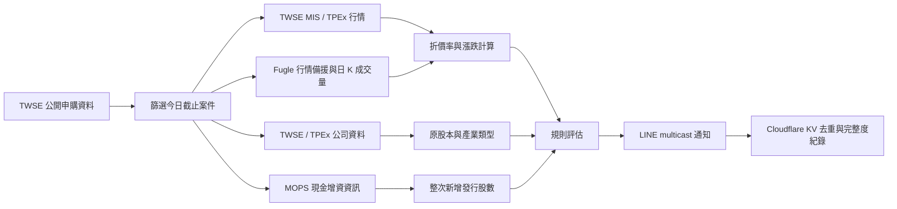

# 台股申購提醒

台股申購提醒是一套以 TypeScript 與 Cloudflare Worker 建立的 LINE 通知工具。
它會整理當日截止的股票公開申購案件，取得行情、公司股本與現金增資資訊，計算
折價率、股數稀釋率與安全邊際，再將規則型評估結果傳送給指定的 LINE 使用者。

本工具的重點不是只顯示「可申購」，而是在資料不完整時保留所有已取得資訊，明確
標示缺漏原因，避免用公開承銷股數冒充整次新增發行股數。

## 功能亮點

- 篩選申購截止日為今天、未取消且屬於股票的公開申購案件。
- 支援上市、上櫃、初上市、初上櫃、第一上市／上櫃與創新板相關案件。
- 上市櫃行情優先使用 TWSE MIS；初上市／初上櫃等尚未正式掛牌案件直接使用
  TPEx 興櫃 OpenAPI，避免查詢尚不存在的 MIS 市場代碼；Fugle 可作上市、上櫃、
  興櫃行情的選配備援。
- 取得原已發行股數與產業類型，並從現金增資重大訊息解析整次新增發行股數。
- 顯示案件類型、目前股價、前收、漲跌、承銷價、折價率、近一個月平均交易量、
  原股本、新增股數、發行後總股數、稀釋率與安全邊際；無最新成交價時可明示
  使用昨日股價。
- 以 `✅ 完整符合`、`🟠 可考慮`、`價差符合，但發行資料不足` 與 `資料不足`
  區分評估結果。
- 個別來源失敗時保留其他來源已取得的欄位；符合條件但資料不足的案件仍會列出。
- 對暫時性 HTTP、timeout 與 LINE 錯誤執行有限重試；官方 JSON 只在同一核准
  HTTPS API 範圍內跟隨有限轉址，不繞過拒絕存取或未知轉址。
- 可在 Cloudflare KV 保存有限期 JSON 快照；即時來源暫時失敗時保留可用資料，
  只有資料日期可能影響判斷時才顯示時效提示，過期或格式無效的內容不採用。
- 可在正式通知前安排無 LINE、無 MOPS 的官方行情與公司資料快照預熱；已掛牌
  案件遇到 MIS 暫時回傳 HTML 時，只能使用兩小時內有效快照，不解析防護頁。
- 支援多位 LINE 收件者、每日去重、資料改善後的更新通知與逾時拒發。
- 錯誤紀錄會移除 token、原始 LINE userId、URL 查詢參數等敏感資訊。

## 判定規則

### 計算方式

```text
市價折價率 =（目前股價 - 實際承銷價）÷ 目前股價 × 100%
股數稀釋率 = 整次新增發行股數 ÷ 發行後總股數 × 100%
安全邊際   = 市價折價率 - 股數稀釋率
```

### 結果分類

| 判定 | 條件 |
|---|---|
| `✅ 完整符合` | 市價折價率嚴格大於 20%，且安全邊際嚴格大於 10 個百分點 |
| `🟠 可考慮` | 市價折價率嚴格介於 10% 與 20%、稀釋率嚴格小於 5%，且安全邊際嚴格大於 10 個百分點 |
| 價差符合，但發行資料不足 | 市價折價率嚴格大於 20%，但缺少原股本或整次新增發行股數 |
| 資料不足 | 缺少完成市價評估所需的必要資料，或個別資料來源最終失敗 |

20%、10%、5% 等邊界值採嚴格比較；等於門檻不視為通過。完整判定只使用整次新增
發行股數，不以公開申購配售股數替代。

## 資料流程



各資料來源的用途與存取邊界請參考
[資料來源與授權邊界](docs/DATA_SOURCES.md)。技術上可存取不代表已取得自動抓取、
重製、轉傳或商業使用授權。

## 快速開始

需要 Node.js 24：

```powershell
npm ci
Copy-Item .env.example .env
npm run check
```

外部來源預設停用，因此首次執行前應先閱讀資料來源文件。確認當時有效的條款、授權
與使用目的後，才將 `.env` 中的設定改為：

```dotenv
ENABLE_EXTERNAL_FETCH=true
ENABLE_MOPS_FETCH=true
```

完成設定後執行：

```powershell
npm run dry-run
```

Dry run 不需要 LINE 憑證，也不會發送訊息。請勿將 `.env`、token、
LINE userId、執行紀錄或 KV 匯出內容提交到 Git。

## LINE 與 Cloudflare Worker

LINE 發送至少需要下列 encrypted secrets：

```text
LINE_CHANNEL_ACCESS_TOKEN
LINE_TARGET_ID_001
```

其他收件者可依序使用 `LINE_TARGET_ID_002` 至 `LINE_TARGET_ID_005`。Worker 的排程
流程還需要自行建立 Cloudflare KV binding `ALERT_HISTORY`，並依實際需求設定 Cron
Triggers。範例 `wrangler.jsonc` 不包含帳號專屬的 KV namespace ID、Cron 或憑證。

排程邏輯支援：

- 12:00 預熱當日行情與公司資料快照；不發 LINE、不查 MOPS、不寫傳送狀態。
- 第一次執行成功後，以 KV 避免同日重複通知。
- 第一次結果含資料缺漏時，後續執行會重新評估；只有完整度改善才傳送更新。
- `LATEST_SEND_TIME` 預設為台灣時間 13:15，超過期限不再傳送當日申購資訊。
- 多位收件者合併為一次 LINE multicast，降低外部請求數量。

部署前必須重新完成資料來源授權、隱私、安全、免費額度與容量評估。Cloudflare Cron
與外部資料來源都不是金融等級 SLA，有限重試與備援排程無法保證每次準時送達。

## 安全與隱私

- 憑證只應存放在本機環境變數或平台的 encrypted secrets。
- Cloudflare KV 僅需保存收件者別名、LINE userId 的 SHA-256 雜湊、傳送時間與資料
  完整度；預設 TTL 為 120 天。
- 日誌不得包含 token、原始 userId、完整敏感 response body 或 URL 查詢參數。
- 發現安全問題時請依 [Security Policy](SECURITY.md) 私下回報。
- 自行部署者應閱讀 [Privacy](PRIVACY.md)，並依使用情境履行告知與資料權利義務。

## 已知限制

- MOPS 頁面結構與公告文字沒有固定 API schema；格式改變時可能無法解析新增股數。
- 官方來源可能暫時回傳 3xx、5xx、空資料或尚未提供新上市股票行情。
- 資料不足時只呈現已確認欄位，不推測、補零或以部分股數替代完整資料。
- 本工具是規則型資訊提醒，不構成投資建議、交易訊號或獲利保證；申購前仍應自行
  查閱公開說明書與最新市場資訊。

## 開發與驗證

```powershell
npm ci
npm audit --registry=https://registry.npmjs.org
npm run check
```

`npm run check` 會執行 TypeScript build、Cloudflare Worker dry-run bundle 與 Vitest。
回報問題或提出建議前請先閱讀 [Contributing](CONTRIBUTING.md)。

## 授權

本專案採用 [Personal Non-Commercial Source License 1.0](LICENSE.md)，僅允許自然人基於
個人、非商業目的查看、複製、執行及修改。禁止商業或組織使用、營利、代管服務、公開
散布、轉售及再授權；如有其他需求，必須事先取得著作權人的書面授權。

這是 source-available 授權，不是 OSI 認可的開放原始碼授權。第三方套件與資料來源仍
適用各自的授權及服務條款。
